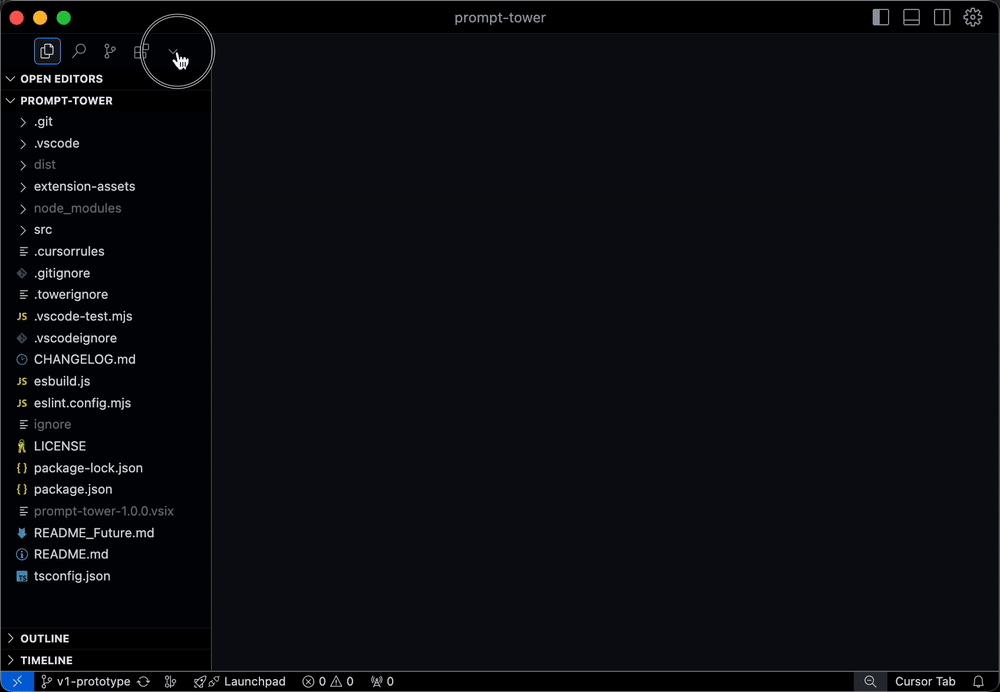

# Prompt Tower


**Turn your entire codebase into AI-ready context in seconds**

[](https://marketplace.visualstudio.com/items?itemName=backnotprop.prompt-tower)
[](https://marketplace.visualstudio.com/items?itemName=backnotprop.prompt-tower)
[](https://marketplace.visualstudio.com/items?itemName=backnotprop.prompt-tower)

## The Problem

Copy-pasting files into Claude, ChatGPT, or Cursor one by one. Losing track of context. Putting too much effort into manual context engineering? **Sound familiar?**

## The Solution

Select files with checkboxes → Generate perfect context → Copy to clipboard → Paste anywhere.

Prompt Tower packages your codebase—files, directory structure, GithHub PR Diffs, GitHub issues—into AI-optimized prompts. Built for developers using Gemini's 1M context, Cursor's agent, Claude Code, or any AI assistant.



**[Install from Marketplace](https://marketplace.visualstudio.com/items?itemName=backnotprop.prompt-tower)** • Works in VS Code, Cursor, Windsurf, Google IDX

---

## What You Get

### Visual File Selection

Click checkboxes. See live token counts. No terminal commands or manual file paths.

### Smart Context Packaging

Every prompt includes your project structure:

```
src/
├── api/GitHubApiClient.ts (5.2KB)
├── models/FileNode.ts (3.1KB)
└── services/TokenCountingService.ts (2.8KB)
```

Plus clean, structured file content:

```xml
<file path="/src/api/GitHubApiClient.ts">
export class GitHubApiClient {
  // Your actual code
}
</file>
```

### Context Control with `.towerignore`

Keep prompts focused. Exclude test fixtures, generated files, or documentation:

```gitignore
tests/fixtures/
dist/
*.test.js
data/
```

### GitHub Issues Integration

Import issues and comments directly. AI understands your problems, not just your code.

### Token Intelligence

Real-time counting prevents surprises. Optimize for any model's limits.

---

## Real Use Cases

**Building features with Cursor's agent:**  
Select implementation files + tests + types → paste complete context → describe your feature → watch it build with full codebase awareness.

**Debugging with Claude Code:**  
Include error logs + related files + directory structure → paste in TUI → get solutions that fit your architecture.

**Massive refactors with Gemini:**  
Use the full 1M context window. Select entire modules, include architectural decisions as prefix text, let AI understand the complete system.

---

## Quick Start

1. Install "Prompt Tower" from VS Code Extensions
2. Click the tower icon in your Activity Bar
3. Check files you need
4. Hit "Copy Context to Clipboard"
5. Paste into any AI chat

---

## Configuration

With `promptTower.useGitignore` enabled (the default), `.gitignore` files in the workspace root and subdirectories are respected. Nested rules apply only within their directory; deeper rules can override earlier rules, but cannot re-include files inside an excluded parent directory. The root `.towerignore` takes precedence over these rules.

**Create `.towerignore`** in your project root (works like `.gitignore`):

```gitignore
# Most important config - keep context relevant
tests/mocks/
docs/generated/
*.min.js
```

**Optional settings:**

- Customize output templates (XML, Markdown, custom)
- Set global ignore patterns
- Configure token warnings

---

## Why Developers Choose Prompt Tower

> "Went from 20 minutes of setup to 20 seconds of context building." - VS Code user

**Before:** Manual file copying, missing context, generic AI responses  
**After:** One-click context, comprehensive understanding, tailored solutions

Perfect for teams that have embraced AI-assisted development but need better context control.

---

## Contributing

Found a bug? Want a feature? [Open an issue](https://github.com/backnotprop/prompt-tower/issues).

**Development:**

```bash
git clone https://github.com/backnotprop/prompt-tower.git
npm install && npm run watch
# Press F5 to launch Extension Development Host
```

---

**[AGPL-3.0 License](LICENSE)** • **[GitHub](https://github.com/backnotprop/prompt-tower)** • Built by [@backnotprop](https://github.com/backnotprop)

<sub>The missing piece between your codebase and your AI assistant.</sub>
